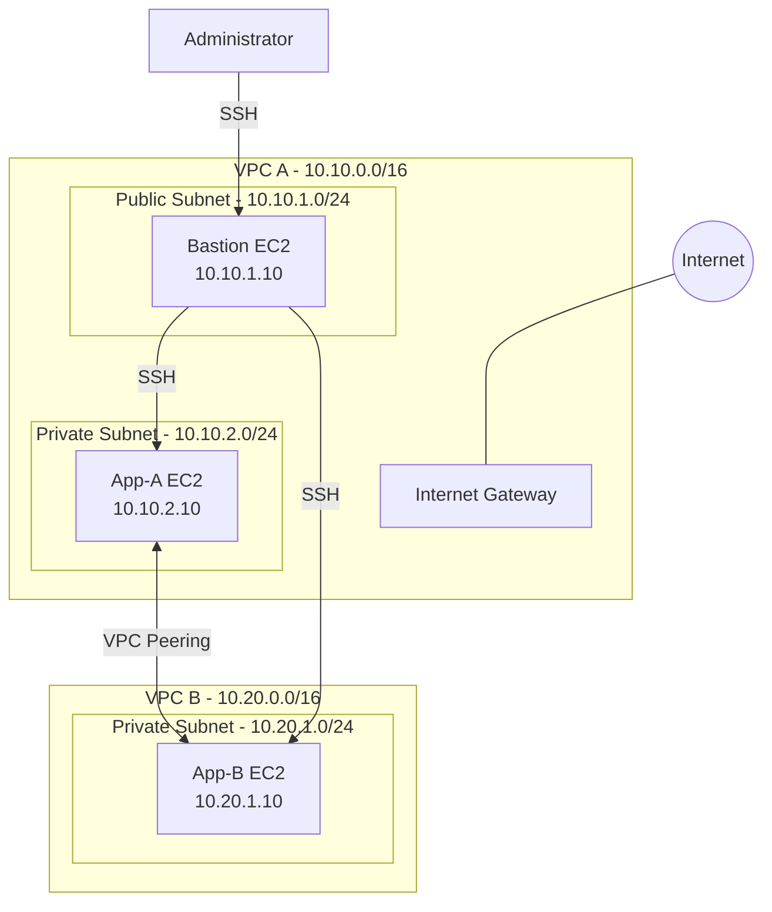

# AWS VPC Peering Architecture

## 1. Introduction

This project demonstrates how to connect two Amazon Virtual Private Clouds (VPCs) using AWS VPC Peering. It allows resources in separate VPCs to communicate privately using their private IP addresses.

## 2. Architecture Diagram

## 3. VPC Configuration

| VPC Name | IPv4 CIDR Block |
|---|---|
| ewb-vpc-a | 10.10.0.0/16 |
| ewb-vpc-b | 10.20.0.0/16 |

The two VPCs use non-overlapping IP address ranges.

## 4. Subnet Configuration

| Subnet Name | VPC | CIDR Block | Type |
|---|---|---|---|
| ewb-a-public | VPC A | 10.10.1.0/24 | Public |
| ewb-a-private | VPC A | 10.10.2.0/24 | Private |
| ewb-b-private | VPC B | 10.20.1.0/24 | Private |

## 5. EC2 Instance Configuration

| Instance Name | Private IP Address | Purpose |
|---|---|---|
| ewb-bastion | 10.10.1.10 | SSH entry point |
| ewb-app-a | 10.10.2.10 | Application instance in VPC A |
| ewb-app-b | 10.20.1.10 | Application instance in VPC B |

The bastion host is placed in the public subnet. App-A and App-B are placed in private subnets and do not require public IP addresses.

## 6. VPC Peering Connection

**Connection name:** ewb
